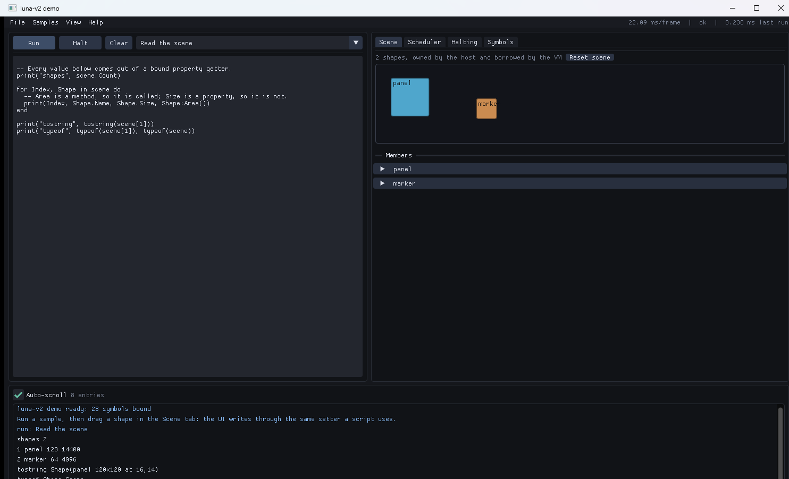

# luna

A small C++20 library for embedding [Luau](https://luau.org). Register native
functions, namespaces, enums and classes with a fluent builder API, then run
scripts against them. Scripts can wait without blocking a thread.

**[Read the documentation →](docs/README.md)**  
[Setup](docs/setup.md) · [Getting started](docs/getting-started.md) · [Registering functions](docs/registering-functions.md) · [Classes](docs/classes-and-userdata.md) · [Tasks](docs/tasks-and-scheduling.md) · [Architecture](docs/architecture.md)

- **Header-light public API.** `#include <luna/luna.hpp>` and link `luna::luna`.
  No Luau type or stack call appears in your code.
- **Staged registration.** Builders append plain data; `Commit()` validates the
  whole batch before anything is linked, and a failure after linking began (a
  value factory that fails, running out of memory) is undone, so a rejected
  commit publishes nothing. `Commit()` returns a result and never throws.
- **A task library.** `task.spawn`, `defer`, `delay`, `cancel` and `wait`, built on the
  scheduler, with `wait` working inside coroutines a script makes itself.
- **Coroutine scheduler.** A native `luna::Suspend(seconds)` yields the running
  chunk and the scheduler resumes it later. Many scripts share one thread.
- **Script signals.** `luna::ScriptSignal` is a signal scripts can make and use:
  `Connect`, `Once`, `Wait`, connection objects, and handlers that run as tasks.
- **Signals.** A host `luna::Signal<void(...)>` takes native and script handlers,
  isolates a throwing handler, and lets a script park on `:Wait()` until the next
  fire instead of polling for changes.
- **Limits on request.** `StateOptions` sets an instruction budget, a memory
  ceiling, and whether to strip the unsafe libraries or sandbox the globals.
- **Native properties and write hooks.** `PropertyPolicy::Notify` runs after a
  successful write, so no wrapper is needed to observe changes.
- **Safe boundary.** Host exceptions become Luau errors a script can `pcall`, and
  argument errors name the symbol and the parameter position.
- **Interruptible.** `State::RequestInterrupt()` is thread-safe and stops a
  runaway chunk, including one inside a loop that never yields, at its next
  safepoint (a loop iteration or a call). No budget is needed.
- **Reflection.** `State::Symbols()` and `State::Reflection()` expose what was
  registered, for autocomplete palettes and tooling.

An interactive ImGui demo is included as a separate target that consumes the
library the same way any host does.

## Build

Requires MSVC (C++20) and CMake 3.20+. Luau is fetched automatically; point
`LUNA_LUAU_SOURCE` at a local tree to use it instead.

```powershell
cmake -S . -B build -G Ninja -DCMAKE_BUILD_TYPE=Release -DLUNA_BUILD_TESTING=ON -DLUNA_BUILD_APP=ON -DLUNA_BUILD_BENCH=ON
cmake --build build
ctest --test-dir build
.\build\LunaBench.exe
```

Targets: static library `luna` (alias `luna::luna`), `luna_tests`,
`luna_boundary_tests`, `LunaApp`, `LunaBench`, `LunaDemo` and
`LunaDemoSelfTest`. Options: `LUNA_BUILD_TESTING`, `LUNA_BUILD_APP`,
`LUNA_BUILD_BENCH`, `LUNA_BUILD_DEMO`.

The demo needs Dear ImGui. It is fetched at a pinned revision by default; set
`LUNA_IMGUI_SOURCE` to an existing checkout to build offline:

```powershell
cmake -S . -B build -G Ninja -DCMAKE_BUILD_TYPE=Release -DLUNA_IMGUI_SOURCE="C:/path/to/imgui"
```

## Use

```cpp
#include <luna/luna.hpp>

struct Sprite {
  std::string Name;
  bool Visible = true;
  double Transparency = 0.0;
};

// A host type opts in with one line, at namespace scope.
template <> struct luna::RegisteredClassTrait<Sprite> : std::true_type {};

luna::State state;

luna::ClassBuilder<Sprite> Sprites = state.Bindings().RegisterClass<Sprite>(
    "Sprite", luna::StableTypeKey("app.Sprite"));

Sprites.Factory("new", [](std::string Name) { return Sprite{Name}; });
Sprites.Field("Name", &Sprite::Name);
Sprites.Property("Visible", [](const Sprite &Self) { return Self.Visible; },
                 [](Sprite &Self, bool Value) { Self.Visible = Value; });
Sprites.Property("Transparency",
                 [](const Sprite &Self) { return Self.Transparency; },
                 [](Sprite &Self, double Value) { Self.Transparency = Value; },
                 luna::PropertyPolicy::Notify(
                     [](Sprite &Self, std::string_view Name) { /* redraw */ }));
Sprites.Method("Destroy", [](Sprite &Self) { Self.Visible = false; });
Sprites.Commit();

state.Bindings()
    .RegisterNamespace("task")
    .RegisterFunction("wait", [](double Seconds) { luna::Suspend(Seconds); })
    .Commit();

luna::ExecutionResult Result = state.Execute(R"(
  local s = Sprite.new("Square")
  s.Visible = false
  task.wait(0.5)
  assert(s.Visible == false)
)");
```

A native callable that calls `luna::Suspend(Seconds)` yields the running chunk and
resumes after that much virtual time. `State::Tick(dt)` advances the clock from the
host loop; `State::Execute` advances it itself so a self-contained script finishes.
`State::Spawn` starts an independent task and returns at its first suspension.

`for k, v in obj do` works when the class binds `ClassOperator::Iterate`.
`ClassOperator::Index` and `NewIndex` answer keys that are not members, and a
declared property still wins over the fallback.

Tables of runtime-decided shape are built with `OwnedValue`, and multiple return
values with `ValuePack`. Variadic functions take an `ArgumentPack`. Luau functions
passed from a script can be held as `Delegate<Signature>` and called back later.

A class returned as a pointer becomes `nil` when the pointer is null, which is how
an index lookup says "absent". A class returned with no registration behind it
raises an error naming the call instead of returning nothing. A container of
`std::optional` writes an absent element as a nil slot.

### Inheritance

```cpp
luna::ClassBuilder<Widget> Widgets =
    state.Bindings().RegisterClass<Widget>("Widget", "app.Widget");
Widgets.Field("Visible", &Widget::Visible);
Widgets.Commit();

luna::ClassBuilder<Sprite> Sprites =
    state.Bindings().RegisterClass<Sprite>("Sprite", "app.Sprite");
Sprites.BaseOf<Widget>("Widget");          // the base must be registered first
Sprites.Method("Destroy", [](Sprite &Self) { Self.Visible = false; });
Sprites.Commit();
```

A script sees `s:IsA("Widget")`, `s.Visible`, and `s:Destroy()`. Inherited methods,
properties, fields and operator fallbacks are flattened into the derived class at
`Commit()`, and anything the derived class declares itself wins. `IsA` accepts the
registered name or its leaf segment.

Inherited members are the base's closures, typed on `Widget&`, so a derived instance
is accepted where a base is expected: marshalling walks the base chain and applies
each class's stored offset, which keeps the answer correct when the base is not the
first subobject. The offset is measured by casting a real aligned buffer, because
the usual null-pointer trick is folded to zero by an optimising compiler.

Members may also be added to an existing class by registering it again; a later
commit extends the class table instead of replacing it. Registering the *same* C++
type under a second name makes that name an alias of the first class: both names
reach the same members, and `IsA` answers for either.

### Definitions

`state.Definitions()` returns `.d.luau` text for everything registered:

```lua
declare Sprite: {
    Destroy: () -> any,
    Visible: any,
}

declare Widget: {
    Visible: any,
}
```

A derived class lists its inherited members alongside its own. Overloaded names emit
`(...any) -> any`. Types are `any` until a type-name trait exists, so the file
documents shape and arity, not parameter types. A class's instance members and its
static ones sit in the same shape. Natively installed members such as `IsA` are not
emitted, and a name that is a Luau keyword is written `["end"]: ...` (a global with
such a name is left out).

### Limits

```cpp
luna::State state{luna::StateOptions{
    /*InstructionBudget=*/50'000'000,
    /*MemoryLimitBytes=*/64u << 20,
    /*StripUnsafeLibs=*/true}};

state.Sandbox();               // after every commit: registration writes globals
double Used = state.MemoryUsed();
```

`RequestInterrupt` works with the default options: Luau calls the state's interrupt
hook at every safepoint (loop back edges, calls and returns), and the hook raises
the host's reason as an error, reported as `ErrorCategory::Interrupted`. The request
stays pending until `ClearInterrupt()`.

An instruction budget is the same hook counting safepoints, so a chunk that never
yields stops by itself once it has used them up. The budget is per resume, so a
script that yields is entitled to run again. It is off by default; there is no
single-stepping, so arming it costs one counter decrement per safepoint.

A memory limit is a ceiling on the allocator, so an oversized allocation fails with
Luau's `not enough memory` and the state stays usable. Running out of memory while a
task is being made or compiled (`Execute`, `Spawn`, `Load`, `Chunk::Call`) is
reported to the caller, never thrown, and a registration that runs out is undone.

`StripUnsafeLibs` removes `io`, `package` and `debug`. `os` stays: Luau's is only
`clock`, `time`, `date` and `difftime`. `StrictMembers` makes reading a member a class
does not have an error ("X is not a valid member of Y") instead of `nil`.

### Tasks and errors

`Execute` runs its script to the end, advancing the scheduler's virtual clock itself,
so a `wait(3600)` moves every other task's time on by an hour too. Use `Spawn` and
`Tick` to keep time under the host's control. `Execute` returns a result whose
`IsPending()` is true when the script parked on a signal instead of finishing.

`Chunk::Call` runs until the chunk finishes or first waits; a chunk that waits keeps
going from `Tick`. A failure in a task nobody is waiting on (a `Spawn`, or anything
`Tick` or `Execute` resumes) goes to `StateOptions::OnTaskError`, with the task id,
or 0 when the source did not compile. A `wait()` that is not inside a task the
scheduler runs (a handler the host calls, a metamethod) is an error, not a no-op.

Every error carries a traceback read from the failed coroutine. A value read into an
`OwnedValue` keeps a table's sequence (holes included) and its named fields; a shared
instance comes back as an instance; functions, vectors and buffers do not. Numbers
are doubles, so an integer beyond 2^53 loses precision on the way in and out, and a
64-bit integer parameter refuses a value outside its range.

### Locked bindings

A script cannot rewrite what the host registered: `getmetatable` on an instance
returns a lock message, class tables and enumerators are read-only, and the host can
still extend a class in a later commit. Instances a bound function returns by pointer
or reference are borrowed; `ClassBuilder::BorrowedFrom(handle)` ties them to a
`LifetimeHandle`, so invalidating it makes a script's copy fail with "the instance is
no longer available". A `State` can be moved: a registry or a `Signal` taken before
the move follows it, and one whose state has gone refuses instead of crashing.
`Delegate` handles must be released on the thread that owns the state.

### Signals

```cpp
luna::Signal<double> Changed;
Changed.Attach(state);                     // for :Wait() only
luna::RegisterSignal(state.Bindings(), "Changed", luna::StableTypeKey("app.Changed"),
                     Changed);

luna::Connection Handle = Changed.Connect([](double Value) { /* react */ });
Changed.Fire(1.5);                         // HandlerCount() == 1
Handle.Disconnect();                       // idempotent
```

A script sees `Changed:Connect(fn)`, `Changed:Disconnect(token)`,
`Changed:GetHandlerCount()` and `Changed:Wait()`. `Wait` parks the chunk with no due
time, so only a fire resumes it: one host thread, no polling loop.

`Fire` runs handlers inline and returns a `FireReport` counting what ran and what
threw, so one broken handler cannot take out the rest. It wakes waiters after the
handlers finish, so the state a waiter observes includes the fire, and `Wait`
returns the values the signal was fired with.

## Demo

`LunaDemo` is an interactive host: one Luau `State`, one ImGui frame loop, and
panels that read back out of the VM rather than out of library internals.



- **Editor** with sample scripts; `F5` or `Ctrl+Enter` to run.
- **Scene** draws bound `Shape` objects and lets you edit them with sliders. Every
  edit is posted through the VM as a property write, so the write hook fires exactly
  as it does for a script.
- **Scheduler** spawns eight scripts, shows them running as coroutines on one
  thread, and exposes the `Tick(dt)` that advances them.
- **Halting** stops a running chunk and reports whether the last run was
  interrupted, using the demo state's instruction budget so the button works even
  mid-loop.
- **Symbols** is the `State::Symbols()` palette, as a tree with a filter.

Two details worth knowing:

1. `Spawn` returns at the first suspension and the host must call `Tick(dt)`;
   `Execute` instead drives its own suspensions to completion, except a wait on a
   signal, which only a fire can resume.
2. A chunk that never yields can only be halted when the state has an instruction
   budget, because every other interrupt point is a call boundary. The demo sets
   one, which is what makes the runaway sample stoppable.

`LunaDemoSelfTest` runs the same harness with no window and no GPU, so the demo's
behaviour is covered by `ctest`.

## Performance

`bench/bench.cpp`, Release `/O2 /Ob2`, median of 5. Each workload runs through the
binding and again as the Luau an author would write by hand for the same effect; the
number shown is the marginal cost (bound minus hand-written). Negative means the
binding is faster.

| Workload | Hand-written | bound | pure Luau | delta | gate |
| --- | --- | ---: | ---: | ---: | ---: |
| property read, 100-member class | `__index` + table read | 57 ns | 49 ns | **8.3 ns** | 45 ns |
| `Vector3` add | table `__add` | 155 ns | 198 ns | **−43 ns** | 60 ns |
| `OwnedValue` table, 8 fields + 2 instances | `build()` with 2 `Sprite.new()` | 1,222 ns | 540 ns | **683 ns** | 1.2 µs |
| `task.wait(0)` yield + resume | — | 262 ns | | **262 ns** | 5 µs |
| register 260 functions + 100 properties | — | 808 µs | | **808 µs** | 25 ms |
| 8 scripts, 1 thread | — | 1 thread | | | 1 + 8 |

A bound property read is a metamethod, so it is compared against a Luau metamethod,
not against a plain table field.

## Design notes

The public headers contain no Luau type, header, or stack operation. One compile
check enforces it: `tests/boundary.cpp` includes each public header alone.
`convert.hpp` is the documented exception: it includes `lua.h`, because inline
codecs and "no Luau in public headers" are mutually exclusive, and the inline codec
is what keeps the hot paths cheap.

Class and member identity are dense `uint32` slots from a monotonic counter.
`Codec<T>` is an inline template specialisation rather than a descriptor plus a
probe. Validation catches everything it can see before anything is linked. Past
that point every write to the VM and the model is logged, so a failure that
validation could not foresee is rolled back rather than left half published.

## Not implemented

`TypeName<T>` (so `.d.luau` can emit real types), `Freeze`, `AsyncTask`,
`Constructor`/`Singleton` (a `Factory` covers both), `ReturnPack`,
`ExecutionPolicy`, annotation macros, and structural type conversion. See
[`docs/architecture.md`](docs/architecture.md#what-was-left-out-on-purpose) for why.
